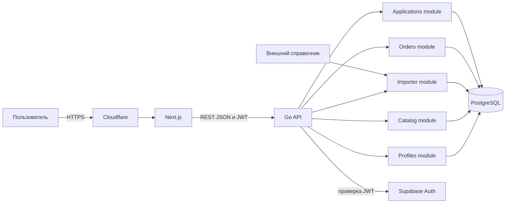
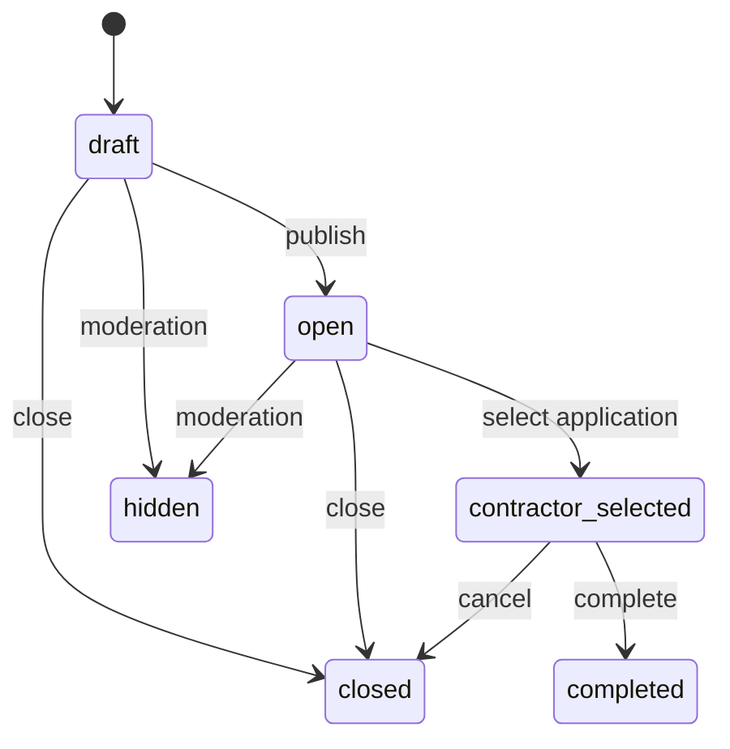
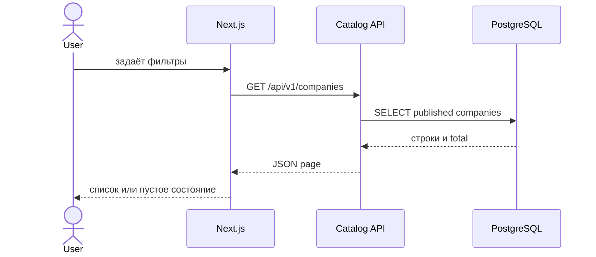
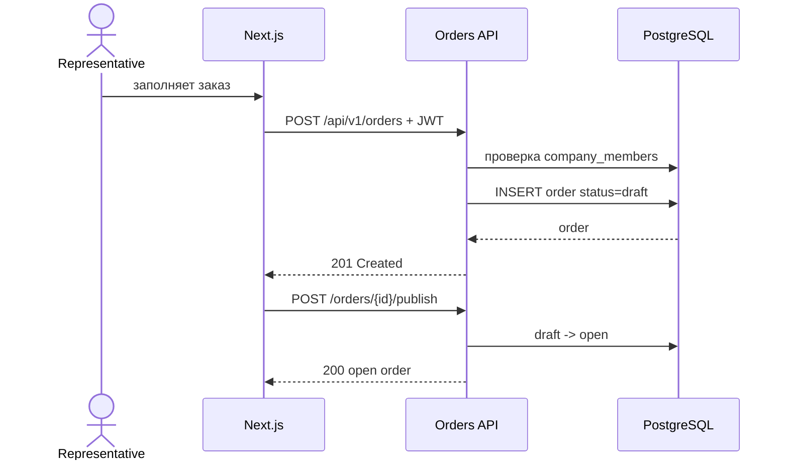
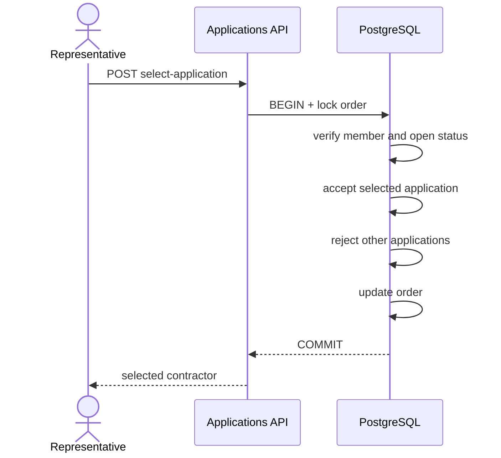

# Архитектура платформы Первый заказ

Документ описывает целевую архитектуру учебной платформы FirstOrder, зоны ответственности компонентов, модель безопасности и полный контракт HTTP API. Платформа помогает начинающим разработчикам находить компании без сайта и откликаться на опубликованные заказы малого бизнеса.

На 12 ноября 2026 года на стенде реализован `GET /health`, frontend использует демонстрационные данные, а PostgreSQL уже содержит согласованную модель из пяти сервисных схем. Остальные эндпоинты ниже являются целевым контрактом для реализации.

# 1. Назначение и границы

## 1.1. Основные сценарии

1. Разработчик открывает каталог, фильтрует компании, изучает контакты, добавляет компании в избранное и отмечает факт контакта.
2. Представитель компании публикует заказ, разработчики отправляют отклики, после чего представитель выбирает одного исполнителя.
3. Модератор проверяет карточки, запросы исправлений и публикации.
4. Сервис импорта загружает компании из внешнего источника и не создаёт дубли при повторном запуске.

## 1.2. Что не входит в MVP

- встроенный чат;
- платежи и безопасная сделка;
- рейтинги и отзывы;
- автоматические уведомления;
- работа с несколькими странами и валютами;
- сложная рекомендательная система.

# 2. Роли и права

| Роль | Возможности |
|---|---|
| Гость | Просмотр опубликованных компаний и открытых заказов |
| Разработчик | Профиль, портфолио, избранное, отметки контакта, отправка и отзыв своих откликов |
| Представитель компании | Управление своей компанией, создание и изменение заказов, просмотр откликов, выбор исполнителя |
| Модератор | Скрытие и публикация карточек, обработка исправлений, просмотр журнала модерации |

Роль `developer` хранится в `profiles.profiles.role`. Представительство компании определяется таблицей `profiles.company_members`, а не глобальной ролью пользователя. Один пользователь может представлять несколько компаний.

# 3. Архитектурный стиль

Для MVP используется модульный монолит на Go: один процесс содержит пять изолированных модулей с отдельными HTTP-обработчиками и слоями доступа к данным. Границы модулей совпадают с пятью схемами PostgreSQL. При необходимости модуль можно вынести в отдельный сервис без переноса его таблиц.



## 3.1. Компоненты

| Компонент | Ответственность |
|---|---|
| Cloudflare | DNS, TLS и защита публичных доменов |
| Next.js frontend | Страницы, формы, клиентская навигация и отображение ошибок |
| Go API | HTTP-контракт, проверка JWT, RBAC, валидация и бизнес-транзакции |
| Supabase Auth | Регистрация, вход, обновление сессии и выдача JWT |
| PostgreSQL | Данные, FK, CHECK, индексы, транзакции и RLS |
| Внешний справочник | Источник исходных сведений о компаниях |

## 3.2. Домены стенда

| Адрес | Назначение | Состояние |
|---|---|---|
| `e1.iq-home.kz` | Go backend | `GET /health` отвечает `200 OK` |
| `e2.iq-home.kz` | Supabase и PostgreSQL | База развёрнута, доступ к Studio защищён |

# 4. Модули backend

## 4.1. Profiles

Отвечает за профили, портфолио и связь пользователей с компаниями.

Таблицы:

- `profiles.profiles`;
- `profiles.portfolio_items`;
- `profiles.company_members`.

## 4.2. Catalog

Отвечает за каталог компаний, категории, избранное, отметки контакта, запросы исправлений и действия модератора.

Таблицы:

- `catalog.categories`;
- `catalog.companies`;
- `catalog.favorites`;
- `catalog.company_contacts`;
- `catalog.correction_requests`;
- `catalog.moderation_actions`.

## 4.3. Importer

Отвечает за запуск импорта, хранение исходных записей, очистку и повторное обновление компаний.

Таблицы:

- `importer.import_runs`;
- `importer.source_records`.

## 4.4. Orders

Отвечает за создание, публикацию и жизненный цикл заказов.

Таблица: `orders.orders`.

## 4.5. Applications

Отвечает за отклики разработчиков и выбор исполнителя.

Таблица: `applications.applications`.

# 5. Правила HTTP API

## 5.1. Базовый адрес

```text
https://e1.iq-home.kz/api/v1
```

Служебный `GET /health` находится вне версионированного API.

## 5.2. Авторизация

Frontend получает JWT через Supabase Auth и отправляет его в каждый защищённый запрос:

```http
Authorization: Bearer <access_token>
```

Go API проверяет подпись, срок действия и `sub` токена. `sub` соответствует `auth.users.id` и `profiles.profiles.user_id`.

Секретный ключ Supabase и пароль PostgreSQL запрещено передавать в браузер.

## 5.3. Формат времени и денег

- время: ISO 8601 в UTC, например `2026-11-12T13:30:00Z`;
- дата: `YYYY-MM-DD`;
- цены: JSON number, валюта MVP — KZT;
- идентификаторы: UUID.

## 5.4. Пагинация

Параметры списка:

```text
page=1&limit=20
```

Максимальный `limit` — 100.

```json
{
  "items": [],
  "page": 1,
  "limit": 20,
  "total": 0
}
```

## 5.5. Формат ошибки

```json
{
  "error": {
    "code": "VALIDATION_ERROR",
    "message": "Запрос содержит некорректные данные",
    "details": {
      "title": "Поле обязательно"
    },
    "request_id": "6ed43ce3-8e67-4c7b-8607-a8d216da2ea1"
  }
}
```

| HTTP | Значение |
|---:|---|
| 200 | Запрос выполнен |
| 201 | Объект создан |
| 204 | Успех без тела ответа |
| 400 | Некорректный JSON или параметры |
| 401 | Нет JWT или он недействителен |
| 403 | Недостаточно прав |
| 404 | Объект не найден или скрыт |
| 409 | Конфликт состояния или дубликат |
| 422 | Поля прошли JSON-парсинг, но нарушают бизнес-правила |
| 500 | Внутренняя ошибка |
| 503 | База или внешний источник временно недоступны |

# 6. Полный каталог эндпоинтов

## 6.1. Состояние системы

| Метод | Путь | Доступ | Назначение |
|---|---|---|---|
| GET | `/health` | Публичный | Проверяет, что HTTP-процесс работает. Не обращается к БД |
| GET | `/ready` | Внутренний/monitoring | Проверяет соединение с PostgreSQL и готовность принимать трафик |

### `GET /health`

Ответ `200`:

```text
OK
```

### `GET /ready`

Ответ `200`:

```json
{
  "status": "ready",
  "database": "up"
}
```

## 6.2. Текущий пользователь и профили

| Метод | Путь | Доступ | Назначение |
|---|---|---|---|
| GET | `/api/v1/me` | Авторизованный | Возвращает профиль, роль и компании пользователя |
| PATCH | `/api/v1/me/profile` | Авторизованный | Изменяет имя, bio, навыки и GitHub URL |
| GET | `/api/v1/profiles/{user_id}` | Авторизованный | Показывает публичную часть профиля и портфолио |
| GET | `/api/v1/me/portfolio` | Разработчик | Список своих работ |
| POST | `/api/v1/me/portfolio` | Разработчик | Добавляет работу в портфолио |
| PATCH | `/api/v1/me/portfolio/{item_id}` | Владелец | Изменяет свою работу |
| DELETE | `/api/v1/me/portfolio/{item_id}` | Владелец | Удаляет свою работу |

### `GET /api/v1/me`

```json
{
  "user_id": "uuid",
  "name": "Иван",
  "bio": "Frontend-разработчик",
  "skills": "React, TypeScript",
  "github_url": "https://github.com/example",
  "role": "developer",
  "companies": [
    {"company_id": "uuid", "member_role": "owner"}
  ]
}
```

### `PATCH /api/v1/me/profile`

```json
{
  "name": "Иван Петров",
  "bio": "Разрабатываю сайты для малого бизнеса",
  "skills": "Go, React, PostgreSQL",
  "github_url": "https://github.com/example"
}
```

Пользователь не может изменить `role`, `user_id` или `is_moderator`.

### `POST /api/v1/me/portfolio`

```json
{
  "title": "Сайт кофейни",
  "description": "Лендинг с меню и контактами",
  "project_url": "https://example.kz"
}
```

Ответ `201` содержит созданный `portfolio_item`.

## 6.3. Представители компаний

| Метод | Путь | Доступ | Назначение |
|---|---|---|---|
| GET | `/api/v1/companies/{company_id}/members` | Представитель/модератор | Возвращает представителей компании |
| POST | `/api/v1/companies/{company_id}/members` | Owner | Добавляет представителя |
| DELETE | `/api/v1/companies/{company_id}/members/{user_id}` | Owner | Удаляет представителя |

### `POST /api/v1/companies/{company_id}/members`

```json
{
  "user_id": "uuid",
  "member_role": "representative"
}
```

Допустимые роли членства: `owner`, `representative`. Нельзя удалить последнего owner компании.

## 6.4. Категории

| Метод | Путь | Доступ | Назначение |
|---|---|---|---|
| GET | `/api/v1/categories` | Публичный | Возвращает категории для фильтра каталога |
| POST | `/api/v1/categories` | Модератор | Создаёт категорию |
| PATCH | `/api/v1/categories/{category_id}` | Модератор | Переименовывает категорию |
| DELETE | `/api/v1/categories/{category_id}` | Модератор | Удаляет категорию; у компаний `category_id` становится `NULL` |

## 6.5. Компании

| Метод | Путь | Доступ | Назначение |
|---|---|---|---|
| GET | `/api/v1/companies` | Публичный | Поиск и фильтрация опубликованных карточек |
| GET | `/api/v1/companies/{company_id}` | Публичный | Детальная карточка компании |
| POST | `/api/v1/companies` | Модератор/importer | Создаёт карточку вручную |
| PATCH | `/api/v1/companies/{company_id}` | Представитель/модератор | Изменяет данные компании |
| PATCH | `/api/v1/companies/{company_id}/visibility` | Модератор | Публикует или скрывает карточку |

### `GET /api/v1/companies`

Параметры:

| Параметр | Пример | Значение |
|---|---|---|
| `q` | `кофе` | Поиск по названию |
| `category_id` | UUID | Фильтр по категории |
| `city` | `Астана` | Фильтр по городу |
| `website_status` | `not_found` | `not_found`, `found`, `needs_review` |
| `page` | `1` | Страница |
| `limit` | `20` | Размер страницы |

Публичный запрос всегда добавляет `visibility=published` на стороне сервера.

### `POST /api/v1/companies`

```json
{
  "name": "Bloom and Brew",
  "category_id": "uuid",
  "city": "Астана",
  "address": "проспект Республики, 1",
  "phone": "+7 700 000 00 00",
  "email": "hello@example.kz",
  "website_url": null,
  "website_status": "not_found",
  "source_url": "https://source.example/company/42"
}
```

### `PATCH /api/v1/companies/{company_id}`

Разрешены только поля карточки. `id`, `created_at` и служебные связи менять нельзя. Представитель не может самостоятельно изменить `visibility`.

### `PATCH /api/v1/companies/{company_id}/visibility`

```json
{
  "visibility": "hidden",
  "reason": "Дубликат карточки"
}
```

Операция создаёт запись в `catalog.moderation_actions`.

## 6.6. Избранное

| Метод | Путь | Доступ | Назначение |
|---|---|---|---|
| GET | `/api/v1/me/favorites` | Разработчик | Возвращает избранные компании |
| PUT | `/api/v1/me/favorites/{company_id}` | Разработчик | Добавляет компанию в избранное, повторный запрос безопасен |
| DELETE | `/api/v1/me/favorites/{company_id}` | Разработчик | Удаляет компанию из избранного |

Для `PUT` используется upsert. Один разработчик не может сохранить одну компанию дважды благодаря составному PK.

## 6.7. Отметки контакта с компанией

| Метод | Путь | Доступ | Назначение |
|---|---|---|---|
| GET | `/api/v1/me/company-contacts` | Разработчик | Список личных отметок контакта |
| GET | `/api/v1/me/company-contacts/{company_id}` | Разработчик | Отметка для конкретной компании |
| PUT | `/api/v1/me/company-contacts/{company_id}` | Разработчик | Создаёт или изменяет отметку |
| DELETE | `/api/v1/me/company-contacts/{company_id}` | Разработчик | Удаляет отметку |

### `PUT /api/v1/me/company-contacts/{company_id}`

```json
{
  "status": "contacted",
  "notes": "Написал в WhatsApp",
  "contacted_at": "2026-11-12T13:30:00Z"
}
```

Статусы: `planned`, `contacted`, `replied`, `declined`.

## 6.8. Запросы исправления карточек

| Метод | Путь | Доступ | Назначение |
|---|---|---|---|
| POST | `/api/v1/companies/{company_id}/correction-requests` | Авторизованный | Сообщает об ошибке в карточке |
| GET | `/api/v1/me/correction-requests` | Авторизованный | Возвращает свои запросы |
| GET | `/api/v1/moderation/correction-requests` | Модератор | Очередь запросов с фильтром по статусу |
| PATCH | `/api/v1/moderation/correction-requests/{request_id}` | Модератор | Одобряет или отклоняет запрос |

### Создание запроса

```json
{
  "message": "Телефон изменился на +7 701 111 22 33"
}
```

### Решение модератора

```json
{
  "status": "approved",
  "resolution_note": "Контакт подтверждён и обновлён"
}
```

Допустимые статусы: `pending`, `approved`, `rejected`. Обработанный запрос нельзя обработать второй раз — возвращается `409 CORRECTION_ALREADY_RESOLVED`.

## 6.9. Заказы

| Метод | Путь | Доступ | Назначение |
|---|---|---|---|
| GET | `/api/v1/orders` | Публичный | Список видимых открытых заказов |
| POST | `/api/v1/orders` | Представитель | Создаёт заказ своей компании в статусе `draft` |
| GET | `/api/v1/orders/{order_id}` | По правилам видимости | Детальная информация о заказе |
| PATCH | `/api/v1/orders/{order_id}` | Представитель своей компании | Изменяет черновик или открытый заказ |
| POST | `/api/v1/orders/{order_id}/publish` | Представитель своей компании | Переводит `draft → open` |
| POST | `/api/v1/orders/{order_id}/close` | Представитель своей компании/модератор | Переводит заказ в `closed` |
| POST | `/api/v1/orders/{order_id}/complete` | Представитель своей компании | Переводит `contractor_selected → completed` |

### `GET /api/v1/orders`

Параметры: `q`, `company_id`, `status`, `budget_from`, `budget_to`, `deadline_before`, `page`, `limit`.

Гостю сервер возвращает только `status=open AND visibility=true`.

### `POST /api/v1/orders`

```json
{
  "company_id": "uuid",
  "title": "Нужен сайт для кофейни",
  "description": "Лендинг с меню, адресом и формой обратной связи",
  "budget_min": 150000,
  "budget_max": 250000,
  "deadline": "2026-12-20"
}
```

Сервер берёт `created_by` из JWT. Пользователь должен состоять в `profiles.company_members` указанной компании.

### Переходы статусов заказа



Статусы: `draft`, `open`, `contractor_selected`, `completed`, `closed`, `hidden`.

## 6.10. Отклики

| Метод | Путь | Доступ | Назначение |
|---|---|---|---|
| POST | `/api/v1/orders/{order_id}/applications` | Разработчик | Отправляет отклик на открытый заказ |
| GET | `/api/v1/orders/{order_id}/applications` | Представитель своей компании/модератор | Возвращает отклики заказа |
| GET | `/api/v1/me/applications` | Разработчик | Возвращает свои отклики |
| GET | `/api/v1/applications/{application_id}` | Автор отклика/представитель заказа/модератор | Детали отклика |
| PATCH | `/api/v1/applications/{application_id}` | Автор, пока `submitted` | Изменяет текст, цену или срок |
| POST | `/api/v1/applications/{application_id}/withdraw` | Автор | Переводит `submitted → withdrawn` |
| POST | `/api/v1/orders/{order_id}/select-application` | Представитель своей компании | Выбирает одного исполнителя |

### `POST /api/v1/orders/{order_id}/applications`

```json
{
  "message": "Сделаю адаптивный сайт на Next.js",
  "proposed_price": 190000,
  "proposed_deadline": "2026-12-15"
}
```

Проверки:

- заказ существует, опубликован и имеет статус `open`;
- разработчик не является владельцем заказа;
- отклик этого разработчика ещё не существует;
- цена неотрицательна;
- срок корректен.

Повторный отклик возвращает `409 APPLICATION_ALREADY_EXISTS`.

### `POST /api/v1/orders/{order_id}/select-application`

```json
{
  "application_id": "uuid"
}
```

Операция выполняется одной транзакцией через `orders.select_application()`:

1. блокирует заказ `FOR UPDATE`;
2. повторно проверяет статус `open` и права представителя;
3. проверяет принадлежность отклика заказу;
4. переводит выбранный отклик в `accepted`;
5. переводит остальные `submitted` в `rejected`;
6. записывает `selected_application_id`;
7. переводит заказ в `contractor_selected`.

### Переходы статусов отклика

```text
submitted → accepted
submitted → rejected
submitted → withdrawn
```

## 6.11. Импорт

| Метод | Путь | Доступ | Назначение |
|---|---|---|---|
| POST | `/api/v1/imports` | Модератор/internal | Запускает импорт асинхронно |
| GET | `/api/v1/imports` | Модератор | История запусков |
| GET | `/api/v1/imports/{run_id}` | Модератор | Статус, счётчики и ошибка запуска |

### `POST /api/v1/imports`

```json
{
  "source": "demo_csv"
}
```

Ответ `202 Accepted`:

```json
{
  "run_id": "uuid",
  "status": "pending"
}
```

Статусы импорта: `pending`, `running`, `completed`, `failed`.

Алгоритм:

1. создать `import_runs`;
2. загрузить внешние записи;
3. нормализовать название, контакты и адрес;
4. выполнить upsert `source_records` по `(source, external_id)`;
5. создать или обновить `catalog.companies`;
6. обновить счётчик и завершить запуск;
7. при ошибке сохранить `failed` и `error_message`.

## 6.12. Журнал модерации

| Метод | Путь | Доступ | Назначение |
|---|---|---|---|
| GET | `/api/v1/moderation/actions` | Модератор | История действий с фильтрами по объекту, действию и дате |

Журнал создаётся backend автоматически при публикации, скрытии, исправлении, одобрении или отклонении. Отдельного публичного POST нет, чтобы пользователь не мог подделать историю.

# 7. Основные последовательности

## 7.1. Просмотр каталога



## 7.2. Публикация заказа



## 7.3. Выбор исполнителя



# 8. Валидация и бизнес-ограничения

| Правило | Где проверяется |
|---|---|
| Один отклик разработчика на заказ | `UNIQUE(order_id, developer_id)` |
| Цена отклика неотрицательна | DB CHECK и API |
| `budget_max >= budget_min` | DB CHECK и API |
| Заказ принадлежит существующей компании | FK |
| Отклик принадлежит существующему заказу | FK |
| Выбранный отклик относится к тому же заказу | Составной FK `(selected_application_id, id)` |
| Один выбранный исполнитель | Транзакция `select_application()` |
| Повторный импорт не создаёт исходный дубль | `UNIQUE(source, external_id)` |
| Пользователь меняет только свои данные | JWT, RBAC и RLS |
| Скрытые карточки не попадают в публичный каталог | Фильтр API и RLS |

# 9. Безопасность

- Внешний трафик принимается только по HTTPS.
- Go API проверяет JWT на каждом защищённом маршруте.
- Проверка владения выполняется повторно непосредственно перед изменением данных.
- SQL строится параметризованными запросами; строки пользователя не конкатенируются в SQL.
- Секреты находятся в переменных окружения и не коммитятся в Git.
- Browser использует только публичный Supabase key; `service_role` остаётся на сервере.
- CORS разрешает только домен frontend.
- Для входа, создания заказов, откликов и исправлений применяется rate limit.
- Ошибки клиенту не содержат SQL, stack trace и секреты.
- Модерационные действия записываются в неизменяемый через публичный API журнал.

# 10. Работа с PostgreSQL

## 10.1. Доступ модулей

В идеальном варианте каждый модуль получает отдельную DB-роль и доступ только к своей схеме. Межсхемные бизнес-операции выполняются ограниченными функциями или через модуль-владелец.

Для учебного MVP допустима одна серверная роль backend, если:

- она никогда не попадает во frontend;
- все запросы проходят через Go API;
- авторизация не делегируется одному только факту подключения к БД;
- права пользователя проверяются на уровне API и RLS.

## 10.2. Транзакции

Транзакция обязательна для:

- выбора исполнителя;
- одобрения исправления с обновлением карточки;
- импорта исходной записи и карточки компании;
- удаления представителя с проверкой последнего owner;
- модерационного изменения с записью журнала.

## 10.3. Вызов функции выбора исполнителя

Текущая функция `orders.select_application(order_id, application_id)` получает пользователя через `auth.uid()`. Такой вариант корректен, только если запрос к PostgreSQL выполняется в контексте пользовательского JWT Supabase.

Если Go API подключается к PostgreSQL напрямую через `pgx` и серверную DB-роль, `auth.uid()` будет пустым. Для этой архитектуры перед интеграцией нужно создать внутреннюю функцию:

```text
orders.select_application(order_id, application_id, actor_id)
```

Go API берёт `actor_id` только из проверенного JWT, а не из JSON пользователя. Право `EXECUTE` выдаётся только backend-роли и отзывается у `PUBLIC`, `anon` и `authenticated`. Функция повторно проверяет членство `actor_id` в `profiles.company_members` и выполняет выбор в одной транзакции.

# 11. Структура backend

```text
backend/
  cmd/api/main.go
  internal/
    platform/
      config/
      database/
      auth/
      httpx/
      logging/
    profiles/
      handler.go
      service.go
      repository.go
      model.go
    catalog/
      handler.go
      service.go
      repository.go
      model.go
    importer/
      handler.go
      service.go
      repository.go
      model.go
    orders/
      handler.go
      service.go
      repository.go
      model.go
    applications/
      handler.go
      service.go
      repository.go
      model.go
```

Слои:

```text
HTTP handler → service/business rules → repository/SQL → PostgreSQL
```

Handler не содержит SQL. Repository не принимает решения о правах пользователя. Service объединяет проверки, транзакции и вызовы репозиториев.

# 12. Наблюдаемость

Каждый запрос получает `request_id`. В JSON-лог записываются:

- timestamp;
- request_id;
- method и path;
- status code;
- duration_ms;
- user_id, если пользователь авторизован;
- безопасный error code.

Не записываются JWT, пароли, полное содержимое личных сообщений и DB secrets.

Минимальные проверки:

- `GET /health` каждые 30 секунд;
- `GET /ready` перед направлением трафика;
- предупреждение при росте 5xx;
- журнал неуспешных импортов;
- резервное копирование PostgreSQL и проверка восстановления.

# 13. Нефункциональные требования

| Требование | Критерий |
|---|---|
| Производительность | 95% обычных GET-запросов отвечают не дольше 500 мс на учебном стенде |
| Доступность | Health-check отвечает успешно не менее 99% времени демонстрационного периода |
| Безопасность | Все защищённые маршруты возвращают 401 без JWT и 403 при недостаточной роли |
| Целостность | Нельзя создать сиротский заказ, отклик или представительство |
| Идемпотентность | Повторный PUT избранного и контакта не создаёт дубликаты |
| Ограничение списка | API не возвращает больше 100 объектов за запрос |
| Восстановление | Резервная копия базы создаётся перед миграцией и может быть восстановлена |

# 14. Реализовано и запланировано

## Реализовано

- `GET /health` на `e1.iq-home.kz`;
- Next.js landing page и локальная фильтрация демонстрационных компаний;
- Supabase/PostgreSQL на `e2.iq-home.kz`;
- 13 прикладных таблиц в пяти схемах;
- внешние ключи, CHECK, индексы и функция выбора исполнителя;
- часть RLS-политик для профилей, портфолио, избранного и контактов.

## Нужно реализовать

1. Общий каркас Go API: config, DB pool, middleware JWT, ошибки и логирование.
2. Profiles и Catalog read API.
3. Подключение frontend к реальному каталогу.
4. Orders и Applications API с транзакцией выбора исполнителя.
5. Модерацию и importer.
6. Полный набор RLS-политик или закрытие БД от прямого клиентского доступа.
7. Создание отдельной DB-роли backend и внутренней версии `select_application` для прямого подключения Go.
8. Интеграционные и сквозные тесты.

# 15. Критерий готовности архитектуры

Архитектура считается реализованной для MVP, когда:

- frontend не использует демонстрационный массив компаний;
- каждый заявленный эндпоинт имеет обработчик или явно исключён из MVP;
- два сквозных сценария проходят через UI, Go API и PostgreSQL;
- чужой заказ и чужой отклик невозможно изменить;
- одновременный выбор двух исполнителей сохраняет только одного;
- повторный импорт не создаёт дубли;
- ошибки API соответствуют единому формату;
- миграции позволяют развернуть базу с нуля.
